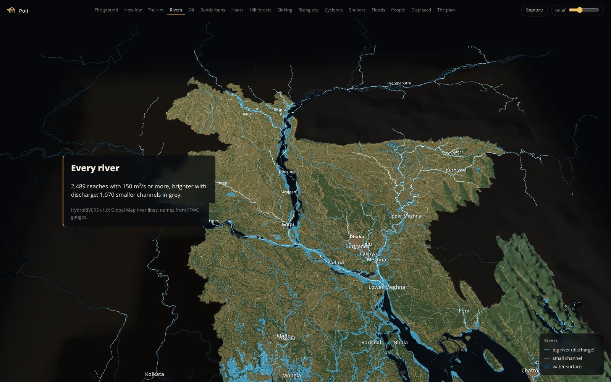

# Poli (পলি): the country the rivers built

A 3D relief story about the Ganges-Brahmaputra-Meghna delta. Bangladesh as a body of river silt: what grows on it, how low it lies, every river that crosses it, the Sundarbans, the haors of Sylhet, the hill forests and what they are losing, how fast the ground sinks, what a rising sea and a cyclone surge do to it, who lives on it, and what has worked to raise it again.

Live page: https://ahasan722.github.io/poli-delta/



Scroll and the relief flies with you. Seventeen short chapters, one claim each, almost no text: the ground is coloured by what the satellite sees on it, and each chapter lifts one thing. A chapter strip across the top jumps anywhere; "Explore" hands you the camera; the relief slider changes the vertical exaggeration from 1× (the truth, flat as a table) to 40×.

## What is in it

| Layer | Source | How it is used |
|---|---|---|
| Relief inside Bangladesh | SRTM 90 m v4.1, CGIAR-CSI (Jarvis et al. 2008), EGM96 | warped to a 1024 × 1148 grid (about 0.7 km a texel), packed as terrain-RGB, displaced in a vertex shader |
| Relief and sea floor around it | ETOPO5 (NOAA NGDC) | far field only, capped at 260 m and faded to black at the grid edge; the Bay is held flat |
| Ground colour | ESA WorldCover 2021, 10 m (ESA / VITO, CC BY 4.0) | majority class per 0.35 km texel: cropland, tree cover, mangrove, wetland, built-up, bare, water; the forest, haor and built-up chapters lift one class at a time |
| Water surfaces | WorldCover water; WFP / LGED "major rivers" polygons; OpenStreetMap 2017 water polygons (ODbL); GSHHS coast; WDBII rivers | merged into one water flag, drawn as dark channels; far rivers as lines |
| River network | HydroRIVERS v1.0 (HydroSHEDS, Lehner & Grill 2013), reaches with long-term discharge ≥ 150 m³/s; Global Map Bangladesh river lines (via BDmaps, MIT) | 2,489 discharge-tinted reaches and 1,070 minor channels as additive lines; 21 river names attached by discharge class (the trunk rivers) and FFWC gauge anchors |
| Forest loss | Hansen Global Forest Change v1.11, tree-cover loss 2001–2023 (CC BY 4.0), Chattogram Hill Tracts | share of each texel that lost canopy, painted red over the relief; annual km² in the chart |
| Haors | Hakaluki and Tanguar haor polygons (Bangladesh GIS data, thesis digitisation) | outlines and areas; the wetland class underneath comes from WorldCover |
| Storm tracks | IBTrACS v04r01, North Indian basin (NOAA NCEI) | every storm since 1960 that reached 34 kt near the delta, drawn as ribbons whose width and height follow wind |
| People | GPW v4 2015 population count (CIESIN), 30 arc-second | one light per texel with 700 or more people, brightness by log count |
| Exposure table | SRTM + GPW | land area and people at or below each 0.25 m step to 10 m |
| The numbers in the text | 196 cited facts in `notes/facts.csv` | sediment (Rahman et al. 2018), Sundarbans accretion (Hale et al. 2019), subsidence (Steckler et al. 2022; Frontiers 2024 review; Auerbach et al. 2015), sea level (Becker et al. 2020), elevation exposure (Kulp & Strauss 2019), floods (BUET series), cyclone tolls and shelters, displacement (IDMC, IOM), TRM and the Delta Plan |

The numbers computed from the files in `raw/`, not quoted: 39.6 % of land at or below 10 m and 13.3 % at or below 5 m (SRTM); 64.4 M people on that land (GPW); 48 % cropland, 39 % tree cover, 2.7 % mangrove (WorldCover, where village groves count as tree cover); 3,965 km² of Sundarbans mangrove on the Bangladesh side. SRTM measures canopy and roofs, so the low-lying shares are floors. Kulp & Strauss showed that a bare-earth model (CoastalDEM) puts five to ten times more people below the flood line than SRTM does; the page says so where it matters.

## Repository

```
index.html, css/, js/, lib/, assets/   the page: vanilla JS, three.js 0.170, d3 7, Open Sans; no build step
data/                                   what the page reads (height.png, mask.png, cover.png, cover_rgb.png, pop.png,
                                        rivers.json, haors.geojson, storms.json, exposure.json, cover_stats.json, ...)
raw/                                    the source rasters and tables the pipeline starts from
pipeline/make_terrain.py                raw -> data: relief, masks, population, exposure
pipeline/make_storms.py                 raw -> data: storm tracks and notes
pipeline/make_cover.py                  raw -> data: land cover, water, forest loss, rivers with names, haors, class areas
pipeline/pipeline.ipynb                 runs all three and checks the quoted numbers
pipeline/shots.py                       chapter screenshots with Playwright, for visual checks
pipeline/verify.py                      functional walk of the page in headless Chromium (chapters, sliders, charts, phone width)
pipeline/rda_raster_to_tif.py, basemap_dat_to_geojson.py, worldcover_downsample.py   how the SRTM, GSHHG and WorldCover files were extracted
notes/facts.csv, sources.md             every number with its URL
notes/data_inventory.md                 where each dataset came from and what was tried and failed
notes/story_candidates.md               the five theses the evidence could carry, graded
```

## Run it

```bash
git clone https://github.com/ahasan722/poli-delta.git && cd poli-delta
python -m http.server 8000        # open http://localhost:8000
```

`?lod=hi` draws the full 1024-column mesh (a real GPU), `?lod=low` a quarter of it (old laptops, screenshots). Default is 512. Colour and water are sampled per pixel from the 2048 × 2296 cover textures, so the coast and the creeks stay sharp at every mesh density.

Rebuild the data: `pip install rasterio geopandas shapely pillow pandas numpy nbclient ipykernel`, then `jupyter nbconvert --execute --inplace pipeline/pipeline.ipynb`. The notebook ends with assertions on every number the page quotes.

Publish: push to `main`, Settings → Pages → branch `main`, folder `/ (root)`.

## How it is drawn

The relief is one `PlaneGeometry`. A custom `ShaderMaterial` decodes height from the terrain-RGB texture in the vertex shader, displaces the vertex, and builds a normal from the four neighbouring texels, so changing the exaggeration is a uniform, not a geometry rebuild. The fragment shader does the rest: the WorldCover palette (or a silt ramp by height where the chapter asks for it), the merged water flag, per-class highlights for forest, mangrove, wetland and built-up land, the Hansen loss share in red, a sea-level uniform that drowns everything at or below it, the low-plain tint, and a slow shimmer on the Bay. Rivers are additive `LineSegments` coloured by log discharge. Storm tracks are ribbon meshes with additive blending so crossings glow. Population is a `Points` cloud with per-point size and a deterministic jitter so the 1 km grid does not read as graph paper. Labels are canvas sprites rescaled every frame to a constant screen size. Chapters are plain objects in `js/story.js` (camera, uniforms, layer opacities); the scroll observer tweens between them, and the chapter strip and legend follow.

## Limits

SRTM is a surface model and the Sundarbans canopy makes the mangroves look like 10 m land. WorldCover is a 2021 composite, so the haors show their dry-season face; the outlines say where the water goes in the monsoon. Protected-area boundaries were not available on any reachable open host, so forests are shown as the satellite sees them, not as the gazette draws them. HydroRIVERS carries no names; the 21 names on the page come from discharge class and FFWC gauge positions and the rest of the network is unnamed on purpose rather than guessed. The river polygons are one epoch of a braided system that moves every year. ETOPO5 outside the border is 9 km coarse and only there for orientation. IBTrACS has no wind for the 1970 Bhola storm; its ribbon uses IMD's 185 km/h at landfall and the note says so. Flood extents by year could not be obtained from any reachable open host, so the flood chapter shows the low plain and a bar chart, not mapped inundation.

## Licence

Code, text and the derived files in `data/`: CC BY 4.0, Abid Hasan, Dhaka, 2026. SRTM v4.1: CGIAR-CSI, free with attribution. ETOPO5 and IBTrACS: NOAA, public domain. ESA WorldCover 2021: ESA / VITO and partners, CC BY 4.0. HydroRIVERS: HydroSHEDS licence, free with attribution. Hansen GFC: CC BY 4.0. OpenStreetMap 2017 water: ODbL, © OpenStreetMap contributors. GPW v4: CIESIN, CC BY 4.0. GSHHG/WDBII: LGPL-3. WFP/LGED river layer and Global Map river lines: open with attribution. Haor polygons: as published by their digitiser. three.js: MIT. d3: ISC. Open Sans: OFL 1.1.

Independent project; not affiliated with any agency named above.
