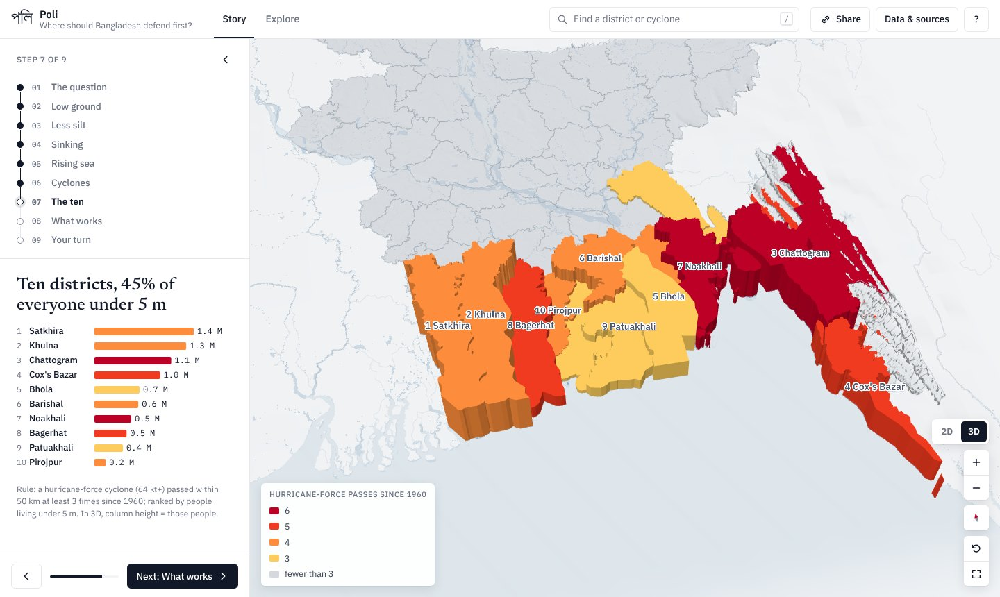

# Poli (পলি): where should Bangladesh defend first?

An interactive map of the Ganges-Brahmaputra-Meghna delta and the Bay of Bengal, in 2D and 3D, that ends in a decision. Ten short steps stack five things on the same map: low ground, a shrinking silt supply, a sinking coast, a rising sea and the cyclone track. They land in the same ten districts, which together hold 45% of everyone living under 5 metres. Then the story turns into a tool: rank the 64 districts yourself.

Live page: https://ahasan722.github.io/poli-delta/



## How it reads

- **v11: wetlands, fish by district, a cyclone tracker.** *Wetlands*: all 373 haors from the DBHWD/BHWDB haor list (area by upazila), each drawn as a circle of its own area on wet ground inside its upazila(s), with the share of each haor district under haor; Chalan Beel, Arial Beel, Beel Dakatia and Baikka Beel; winter waterbird counts at Tanguar, Hakaluki and Baikka Beel, the five coastal priority sites for migrants, and birds arriving down the Central Asian and East Asian-Australasian flyways. *Fish by district* (2024-25, DoF yearbooks): all inland fish, farmed, caught and shrimp and prawn farms on the district columns, the national series since 1983-84 and production by kind of fish. *Cyclones* is its own tab: all 90 storms in a list you can search and filter by strength and season, each with a sparkline of its wind; pointing at one lights its track, clicking plays it with a ring that follows the eye. The top tabs gained a sliding underline and sections slide in.
- **Atlas tabs (v10).** Beside the story, four sections with their own panel, map layers and charts. *Rivers*: the six junctions where the big rivers meet (Chilmari, Bhairab, Goalundo, Chandpur, Markuli, Agunmukha), with mean flow in and out (HydroRIVERS) and the nearest FFWC gauge. *Fish*: hilsa landings since 2008-09, the six hilsa sanctuaries and their closed months, the hilsa run moving upriver, the Halda's egg collection by year, and the three fishing grounds in the Bay. *Crops*: landscapes or a crop, with the top districts. *Hazards*: cyclones on a day-of-year clock (two seasons, April to June and October to December) with storms per decade; floods as the share of the country under water since 1954 and FFWC gauges raised by how far their record went above the danger level; river erosion along the Jamuna, Padma and Ganges since 1973 (CEGIS) and the coast losing ground.
- **The Bay and its rivers.** The second step opens on the whole Bay of Bengal, shaded by depth (ETOPO5), with every river in the frame moving toward it: HydroRIVERS reaches inside Bangladesh, WDBII beyond the border. A shader moves the water down each line from its higher end, faster in rivers with more discharge (the Lower Meghna about 40,000 m³/s, the Padma 35,000, the Jamuna 21,000).
- **What it grows.** A step on the land itself: BARC's 30 agro-ecological zones grouped into five landscapes (coast, river floodplains, haor and bil basins, Barind and Madhupur terraces, hills), coloured on the map, with the share of the land and of each crop in each landscape. The coast is 23% of the land and grows about 30% of the Aus rice and 20% of the Aman, but little wheat or potato. Crops are split across a district's zones by area, which assumes a crop is spread evenly over the district.
- **Explore as a layer tree.** The Explore panel works like a GIS layer list: choose what colours the districts (cyclone exposure and people, landscape, or a crop), with its controls and key opening under the choice; switch overlays on and off; read the ranking for the theme in force.
- **Status bar.** Along the foot of the map: a live scale bar, the position under the pointer and the district there, what the mouse can do in this step, and the view's bearing and tilt. It replaces the one-time hint, so the map explains itself.
- **District sheet.** Click a district (or search for one) for a sheet in four tabs, each drawing its charts as it opens. Overview: the verdict under the rule, the number of people under 5 m, and where the district sits among the 64 on five measures. Rivers: kilometres of mapped channel, channel density, the water share of the land and the named rivers by mean flow. Farming: its agro-ecological zones (BARC 2018), its land cover and its share of national output for Aman, Boro and Aus rice, wheat and potato, with the rank among the 64. Cyclones: every pass within 50 km since 1960, with a play button for each hurricane-force storm.
- **Crops on the map.** In Explore, pick a crop to colour and raise the 64 districts by production (ColorBrewer YlGn, quintile classes) and rank them.
- **Cyclone picker.** A button on the map lists the fourteen named cyclones since 1970 with peak wind and deaths; choosing one plays it.
- **Map layers.** A layers menu on the map turns rivers and flow, river names, places, district borders, cyclone tracks and the depth of the Bay on or off; each step sets its own layers and changes last until the next step.
- **About page.** Project, how to read it, the rule, data, how it is drawn, limits and credits, with its own link (`#page=about`).
- **2D or 3D, any time.** The 2D | 3D switch (or keys 2 and 3) is one scene seen two ways. 2D is a flat, north-up map; 3D tilts the camera, then raises the relief, then grows the district columns tallest first, in 1.4 s. The switch reverses exactly, can be interrupted half way without a jump, and keeps the same centre and zoom. The mode is in the URL.
- **A stepper, not scroll-jacking.** Previous / Next, a numbered step list with a progress line, arrow keys, and the wheel over the story panel move between steps. The wheel over the map zooms it. Each step flies the camera to its own framing (1.2 to 1.8 s, eased, arcing over long moves).
- **Timelines you control.** Steps that change over time (ground under a cutoff, ground lost, sea level rise, cyclone years 1960 to 2025) play once on arrival and can be paused, scrubbed or run at 2×. A cyclone picked in Explore gets its own timeline in days, with the wind at each fix.
- **The ten.** Height = people living under 5 m (3D), colour = how many times a hurricane-force cyclone (64 kt+) passed within 50 km since 1960. The rule is printed on the page: at least 3 such passes, ranked by people under 5 m.
- **Explore.** Change the rule, search any district or named cyclone, hover for a tooltip, click for a sheet that opens with the district's verdict and every value ranked among the 64. Drag to pan, scroll to zoom, right-drag or Ctrl-drag to turn and tilt, the compass resets north.
- **Production details.** Every step, mode and selection is a link (`#step=9&mode=2d&id=khulna`, `#step=9&storm=sidr-2007`); Back and Forward work. Share copies the link. `?` lists the shortcuts. The panel folds away (`[`). Loading shows real progress; a first-visit hint is dismissed once. On phones the map fills the screen and the story is a bottom sheet with three stops. Reduced-motion users get instant changes and complete timelines. Without WebGL the page falls back to a flat SVG map with the same colours.

**Colour.** The interface is neutral: white, greys and ink. The base map is neutral grey (land #e9ecef, water #dbe4ea) so the data is the only saturated thing on screen. Data colours come from one file, `js/palette.js`: ColorBrewer YlOrRd for cyclone exposure and wind, Blues for the sea taking the land, YlGnBu for ground under a height cutoff, one Okabe-Ito accent for the tidal river management site; selection is drawn in ink, not a hue. Column caps are unlit, so a district's colour on screen matches its key swatch in 2D and in 3D. `pipeline/colours.py` checks the ramps under simulated deuteranopia and protanopia (adjacent classes ΔE > 10) and the text contrast (WCAG AA).

**Type and layout.** Newsreader for headlines, IBM Plex Sans for the interface, IBM Plex Mono for numbers. 8 px spacing, one 6 px radius, a shadow only on what floats over the map.

## What is in it

| Layer | Source | How it is used |
|---|---|---|
| Relief inside Bangladesh | SRTM 90 m v4.1, CGIAR-CSI (Jarvis et al. 2008), EGM96 | warped to a 1024 × 1148 grid (about 0.7 km a texel), packed as terrain-RGB, displaced in a vertex shader |
| Relief and sea floor around it | ETOPO5 (NOAA NGDC) | far field only, capped at 260 m and faded to black at the grid edge; the Bay is held flat |
| Ground colour | ESA WorldCover 2021, 10 m (ESA / VITO, CC BY 4.0) | majority class per 0.35 km texel, sampled per pixel; the forest, haor and built-up chapters lift one class at a time |
| Water surfaces | WorldCover water; WFP / LGED river polygons; OpenStreetMap 2017 water polygons (ODbL); GSHHS coast; WDBII rivers | merged into one water flag, drawn as dark channels; far rivers as lines |
| River network | HydroRIVERS v1.0 (Lehner & Grill 2013), reaches with discharge ≥ 150 m³/s; Global Map river lines (via BDmaps, MIT) | 2,489 discharge-tinted reaches and 1,070 minor channels; 21 names by discharge class and FFWC gauge anchors |
| Forest loss | Hansen Global Forest Change v1.11, loss 2001–2023 (CC BY 4.0), Chattogram Hill Tracts | share of each texel that lost canopy, painted red; annual km² chart; per-district total |
| Haors | Hakaluki and Tanguar polygons (thesis digitisation) | outlines and areas |
| Districts | Bangladesh Bureau of Statistics, Population and Housing Census 2022 GIS layer (64 zila polygons with the census count), via justinelliotmeyers/bangladesh_2022_census_gis | id raster for picking, outlines, and one profile per district computed on the scene grid |
| Storm tracks | IBTrACS v04r01, North Indian basin (NOAA NCEI) | 90 storms since 1960 that reached 34 kt near the delta: ribbons whose width and height follow wind; the playback vortex takes each fix's position and maximum wind |
| Storm impacts | EM-DAT public table (CRED / UCLouvain), Bangladesh extract; landfall and surge from the article cited per row in `raw/disasters_emdat_bgd/SOURCE.md` | the storm card |
| Climate | World Bank CCKP / CRU TS country series 1901–2011 (Kaggle re-host, repaired, see `REPAIR_LOG.txt`); BMD 24 quality-controlled stations 1982–2022; BMD 33 stations monthly 1948–2013 (Gauhar et al. 2021 compilation) | temperature anomaly chart, monthly rainfall chart, station columns on the relief |
| Sea level | PSMSL annual RLR for the Bay of Bengal gauges (Holgate et al. 2013); CSIRO GMSL reconstruction (Church & White) | one row per gauge with an OLS trend; the global mean for context |
| People | GPW v4 2015 population count (CIESIN), 30 arc-second | one light per texel with 700 or more people; people under 10 m per district |
| Exposure table | SRTM + GPW | land area and people at or below each 0.25 m step to 10 m |
| Agro-ecological zones | BARC, Fertilizer Recommendation Guide 2018, table of zones and their main districts (OCR pages kept in `raw/aez_barc_frg2018/`, transcribed in `aez_districts.csv`) | the Farming tab |
| Major crops by district | BBS, 45 Years Agriculture Statistics of Major Crops, via data.gov.bd (`raw/agri_bbs_major_crops/`) | per crop, the latest year whose 64 district figures add up to the table's national total: Aman 2011-12, Boro 2012-13, Aus, wheat and potato 2014-15 |
| The numbers in the text | 196 cited facts in `notes/facts.csv` | sediment, subsidence, sea level, exposure, floods, cyclone tolls and shelters, displacement, TRM and the Delta Plan |

Numbers computed from the files in `raw/`, not quoted: 39.6 % of land at or below 10 m and 13.3 % at or below 5 m (SRTM); 64.4 M people on that land (GPW); 48 % cropland, 39 % tree cover, 2.7 % mangrove (WorldCover); 3,965 km² of Sundarbans mangrove; +0.23 °C a decade at the BMD stations since 1982; 72 % of a station's rain in June–September; every tide gauge with a usable record trending up. The notebook asserts each of them.

## Repository

```
index.html, css/, js/, lib/, assets/   the page: vanilla JS, three.js 0.170, d3 7, Newsreader + IBM Plex (OFL); no build step
  js/terrain.js                        the relief shader (height, cover, water, low-ground tint, sinking, drowning, district pick)
  js/layers.js                         storms, flowing rivers, district outlines, district columns (extruded outlines), labels
  js/wind.js                           the particle wind field and the storm player
  js/story.js                          the steps: a ground box to frame, relief uniforms, layers, and an optional timeline
  js/main.js                           camera controller and flights, the 2D/3D choreography, steps, timeline, URL state, search, input, render-on-demand loop, SVG fallback
  js/palette.js                        every colour (ColorBrewer ramps, base greys, one accent)
  js/icons.js                          the line icons used across the page
  js/charts.js, js/cards.js            the two panel charts (silt, the ten); the district and storm sheets
data/                                  what the page reads (height, mask, cover, pop, district_id PNGs; rivers, storms,
                                       districts, climate, sealevel, cyclones_impact, exposure JSON; outlines GeoJSON)
raw/                                   the source rasters and tables, each directory with a SOURCE.md
pipeline/make_terrain.py               raw -> data: relief, masks, population, exposure
pipeline/make_storms.py                raw -> data: storm tracks and notes
pipeline/make_cover.py                 raw -> data: land cover, water, forest loss, rivers with names, haors
pipeline/make_districts.py             raw -> data: district id raster, outlines, 64 profiles (people under 2/5/10 m, hurricane-force passes)
pipeline/make_climate.py               raw -> data: climate series, tide gauges, EM-DAT impact rows
pipeline/make_agri.py                  raw -> data: agro-ecological zones, major crops and rivers per district (agri.json)
pipeline/pipeline.ipynb                runs all five and asserts the quoted numbers
pipeline/verify.py                     functional walk in headless Chromium: 2D/3D switch and its interruption, rendered colour vs key, steps, keys, Back, deep links, wheel, drag, timeline, hover, click, search, a cyclone, frame times, reduced motion, no-WebGL fallback, phone; writes screenshots
pipeline/colours.py                    palette checks: colour-blind simulation, class gaps, contrast
pipeline/shots.py                      chapter screenshots at any viewport
pipeline/rda_raster_to_tif.py, basemap_dat_to_geojson.py, worldcover_downsample.py   how the SRTM, GSHHG and WorldCover files were extracted
notes/facts.csv, sources.md            every number with its URL
notes/data_inventory.md                where each dataset came from and what was tried and failed
notes/story_candidates.md              the five theses the evidence could carry, graded
```

## Run it

```bash
git clone https://github.com/ahasan722/poli-delta.git && cd poli-delta
python -m http.server 8000        # open http://localhost:8000
```

`?lod=hi` draws the full 1024-column mesh (a real GPU), `?lod=low` a quarter of it with fewer wind particles (old laptops, screenshots). Default is 512 columns and 4,500 particles.

Rebuild the data: `pip install rasterio geopandas shapely pillow pandas numpy nbclient ipykernel`, then `jupyter nbconvert --execute --inplace pipeline/pipeline.ipynb`. Check the page: `pip install playwright && python pipeline/verify.py http://localhost:8000/index.html`.

Publish: push to `main`, Settings → Pages → branch `main`, folder `/ (root)`.

## How it is drawn

The relief is one `PlaneGeometry`. A custom `ShaderMaterial` decodes height from the terrain-RGB texture in the vertex shader, displaces the vertex, and builds a normal from the four neighbouring texels, so changing the exaggeration is a uniform, not a geometry rebuild. The fragment shader samples the cover, water, and district-id textures per pixel (so coasts and creeks stay sharp at any mesh density) and does the rest: the WorldCover palette or a silt ramp, per-class highlights, the Hansen loss share in red, a sea-level uniform that drowns everything at or below it, the low-plain tint, the picked district kept lit while the rest dims.

The camera is a pose (a look point on the ground, a distance, a pitch from straight down and a bearing) with a target that input and flights move and a rendered copy that follows it with frame-rate-independent damping, x += (target − x)(1 − e^(−k·dt)). A flight interpolates the look point, log distance, pitch and bearing (shortest way round) with easeInOutCubic and an arc on long moves; any drag, wheel or pinch cancels it from where it is, so nothing snaps. One number, dimP, runs the 2D/3D switch: the first half tilts the camera from straight down (north up) to the step's pitch and bearing, the middle raises the relief uniform from 0, the last part grows each column with a 25 ms stagger by rank; labels fade during the change and during flights. Values on screen (uniforms, layer opacities, the timeline's value) ease toward each step's targets. The loop renders only while something moves, so an idle page costs nothing. Each step names a box of ground, and `fitView` projects its corners through a probe camera until they fit the part of the stage that the panel, the sheet or the phone sheet leave uncovered (`setViewOffset`). Picking is a ray against the ground plane, refined twice against the sampled height, then a lookup in the district-id raster; no raycast against the mesh. District columns are `ExtrudeGeometry` from each BBS outline, scaled in y. Rivers are `LineSegments` coloured by log discharge. Storm tracks are ribbon meshes; the selected one is revealed with `drawRange` as the vortex advances. Rivers carry a per-vertex distance along the reach, and a line shader moves a pulse down it. The wind is a few thousand particles, each drawn as a six-point streak from a ring buffer of its last positions, advected by a Rankine vortex (linear to the radius of maximum wind, decaying as r^-0.62 beyond, with a small inflow) placed at the interpolated IBTrACS fix, plus a faint drift so the Bay is never still. Labels are canvas sprites rescaled every frame to a constant screen size. Chapters are plain objects in `js/story.js`.

## Limits

SRTM is a surface model and the Sundarbans canopy makes the mangroves look like 10 m land; the low-lying shares are floors. WorldCover is a 2021 composite, so the haors show their dry-season face. Protected-area boundaries were not available on any reachable open host, so forests are shown as the satellite sees them. HydroRIVERS carries no names; 21 come from discharge class and FFWC gauge positions and the rest of the network is unnamed on purpose. The wind field is a textbook vortex on two numbers per fix, not a reanalysis; real storms are wider, wetter and lopsided. The CRU country series steps 0.6 °C low after 2011 in its Kaggle re-host and is cut there; the BMD series carries the recent decades. PSMSL has no Bangladesh gauge after 2003 except Chittagong, and Khepupara carries a datum problem. EM-DAT tolls differ from government tolls (Sidr 4,234 against 3,406); the card says which it shows. District statistics are computed on a 0.7 km grid, so small districts carry grid error. The ranking rule (3 hurricane-force passes, people under 5 m) is a transparent screen, not a cost-benefit model; the explore tools exist so a reader can change it. Vertical exaggeration is a reading aid.

## Licence

Code, text and the derived files in `data/`: CC BY 4.0, Abid Hasan, Dhaka, 2026. SRTM v4.1: CGIAR-CSI, free with attribution. ETOPO5 and IBTrACS: NOAA, public domain. ESA WorldCover 2021: CC BY 4.0. HydroRIVERS: HydroSHEDS licence. Hansen GFC: CC BY 4.0. OpenStreetMap 2017 water: ODbL, © OpenStreetMap contributors. GPW v4: CIESIN, CC BY 4.0. GSHHG/WDBII: LGPL-3. BBS Census 2022 GIS layer: Bangladesh Bureau of Statistics, as published. BMD station records: Bangladesh Meteorological Department, via the cited compilations. PSMSL: free with acknowledgement. CSIRO GMSL: ODC-PDDL via datasets/sea-level-rise. EM-DAT: CRED / UCLouvain, non-commercial use with citation (only the Bangladesh extract is kept). three.js: MIT. d3: ISC. Newsreader, IBM Plex Sans and Mono: SIL OFL 1.1. Colours: ColorBrewer (Brewer & Harrower), Apache 2.0; one Okabe & Ito (2008) accent.

Independent project; not affiliated with any agency named above.
